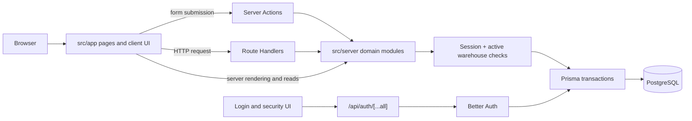

# Architecture

Inventorier is a Next.js App Router application backed by PostgreSQL through Prisma. The route tree provides the UI and HTTP entry points; server-side domain modules apply identity, warehouse, and business rules before accessing the database.

## Request and rendering boundaries

- [The root layout](../src/app/layout.tsx) supplies the document shell, global styles, metadata, theme initialization, and install prompt. Pages under `src/app` are server-rendered by default; interactive forms and widgets opt into the client boundary with `"use client"`.
- Pages commonly read through `src/server` modules and pass results into client components. For writes, client forms call exported `"use server"` functions in route-local action files. Those actions parse form input, call domain functions, and return action state or redirect/revalidate as appropriate. For example, [the item actions](../src/app/items/actions.ts) delegate to [the item domain](../src/server/items/create-item.ts) and related operations.
- HTTP integrations use Route Handlers rather than Server Actions. [The Better Auth handler](<../src/app/api/auth/[...all]/route.ts>) exposes Better Auth endpoints; item barcode handlers provide lookup and barcode image responses. Both entry-point styles rely on server-side checks—UI visibility alone is not authorization.
- Domain modules are marked server-only and centralize persistence and rules. [The Prisma client](../src/lib/db/prisma.ts) uses the PostgreSQL adapter; the maintained model definition is [the Prisma schema](../prisma/schema.prisma). The generated client under `src/generated/prisma` is build output, not a source module to edit.

## Identity and authorization

[Better Auth configuration](../src/lib/auth.ts) integrates credential sign-in, email verification, TOTP, passkeys, and session persistence with Prisma. The catch-all auth route forwards HTTP requests to it. Login, registration, password-change/reset, and account-security screens use that API and app-specific server actions. Password-reset and email operations also use the server email/settings modules.

[Optional OIDC sign-in](oidc.md) uses Better Auth's generic OAuth plugin with provider configuration loaded from administrator settings. The auth route creates the provider for the current settings revision, and account creation/linking still results in ordinary app roles and warehouse permissions; IdP groups are not synchronized.

[Session helpers](../src/server/auth/get-current-user.ts) load the active account from the database, not just the session cookie. They reject inactive users and enforce required password changes. [Global role checks](../src/server/auth/permissions.ts) distinguish `ADMIN` from `USER`; warehouse access adds a separate membership role.

## Warehouse isolation and roles

`Warehouse` owns its `Location` and `Category` records. A `WarehouseMember` links users to a warehouse with `USER` or `MANAGER` access. Global `ADMIN` users can access all warehouses; other users need a membership. The active warehouse is selected by the `active-warehouse-id` cookie, but that cookie is only a selection hint: [current-warehouse resolution](../src/server/warehouses/current-warehouse.ts) checks accessible warehouses and falls back to one the user can access.

Reads and writes go through [warehouse permission helpers](../src/server/warehouses/permissions.ts). They re-check active-user and membership state inside a transaction, and domain queries constrain records to the current warehouse. Item membership is derived through its location; item creation and updates also verify that selected locations and categories belong to that same warehouse. [Transaction locking and access checks](../src/server/warehouses/transaction-lock.ts) coordinate access with membership and warehouse changes. [Warehouse management](../src/server/warehouses/manage-warehouses.ts) additionally guards deletion and membership updates; deletion checks for cross-warehouse relationships before removing dependent data.

Warehouse `MANAGER`s (and global admins) manage warehouse data such as items, categories, and locations. Regular `USER` members can read their warehouse and change quantities of active items. Global user administration is separate from these per-warehouse permissions.

## Inventory and history

An `Item` has a unique barcode, integer quantity and unit, a required location, optional category, and an `isArchived` flag. Locations can form a parent/child hierarchy. Archive is a reversible state: the item actions call archive/restore domain functions rather than treating ordinary item deletion as a hard delete.

Item history is an append-only event record associated with an item and (when available) the acting user, with an actor name, event type, timestamp, and optional old/new values or description. Item creation, metadata/location changes, quantity changes, archiving, and restoration create history entries in the same transaction as the corresponding mutation. [Item reads](../src/server/items/get-item.ts) include history and are scoped to the current warehouse. Quantity changes lock the item row and write the new quantity and event atomically in [the quantity domain operation](../src/server/items/change-item-quantity.ts).

## Where to start

- Follow a page-to-domain read from [the item list page](../src/app/items/page.tsx) to [item listing](../src/server/items/list-items.ts).
- Follow a write from [the item form actions](../src/app/items/actions.ts) to [item creation](../src/server/items/create-item.ts).
- For shared access rules, start at [current warehouse](../src/server/warehouses/current-warehouse.ts), then [warehouse permissions](../src/server/warehouses/permissions.ts).
- For persisted entities and relations, read [the Prisma schema](../prisma/schema.prisma).

See the [module reference](module-reference.md) for the source map.
